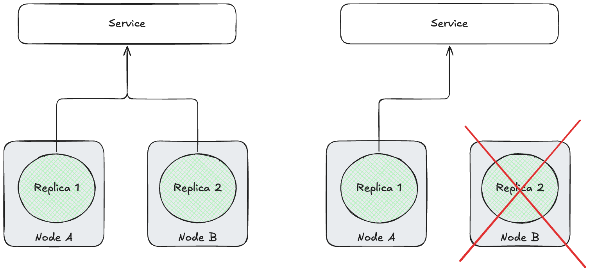
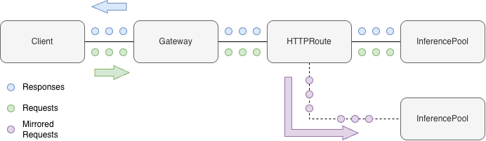
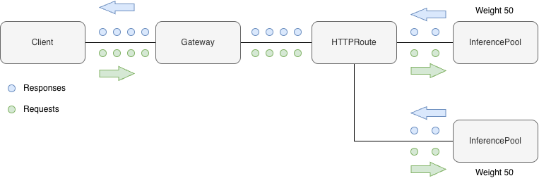

# High Availability

When serving your models in OpenShift, you want to ensure that they aren't going to suddenly stop for any reason, causing downtime. Of course, **you could run several replicas of your model** to help minimize this risk, but there are some additional techniques you can employ.

## Pod Anti-Affinity

"Pod anti-affinity" means to ensure that an application's pod replicas, on OpenShift, are not running on the same node. This protects the application's uptime, in events that cause the node to fail, such as a hardware failure.



While this is an OpenShift concept, it can still be applied to Red Hat OpenShift AI workloads. If you were to deploy several replicas of a small model that can fit on a single GPU, if you have worker nodes with >1 GPUs, there's a chance they are scheduled to the same node, if you haven't configured anti-affinity rules.

### LLMInferenceService Example

Below is an example of how you can set up anti-affinity on your LLMInferenceService CR.

!!! note
    This will need to be added to the CR after deploying the model, it cannot be set up in the UI (as of RHOAI 3.5.0). 

```yaml
apiVersion: serving.kserve.io/v1alpha1
kind: LLMInferenceService
metadata:
  name: qwen3
spec:
  model:
    name: qwen3
    ...
  replicas: 2
  template:
    affinity:
      podAntiAffinity:
        requiredDuringSchedulingIgnoredDuringExecution:
          - labelSelector:
              matchExpressions:
                - key: serving.kserve.io/inferenceservice
                  operator: In
                  values:
                    - qwen3
            topologyKey: kubernetes.io/hostname
    ...
```

### InferenceService Example

Below is an example of how you can set up anti-affinity on your InferenceService CR.

!!! note
    This will need to be added to the CR after deploying the model, it cannot be set up in the UI (as of RHOAI 3.5.0). 

```yaml
apiVersion: serving.kserve.io/v1beta1
kind: InferenceService
metadata:
  name: qwen3
...
spec:
  predictor:
    affinity:
      podAntiAffinity:
        requiredDuringSchedulingIgnoredDuringExecution:
          - labelSelector:
              matchExpressions:
                - key: serving.kserve.io/inferenceservice
                  operator: In
                  values:
                    - qwen3  #ISVC name
            topologyKey: kubernetes.io/hostname
  ...
  minReplicas: 2
  maxReplicas: 2
```

### Proof

To see this in action, you need to scale your model to 1 more than the number of GPU nodes you have. I.e. for the following, assume I have 2 GPU nodes.

```bash
# For LLMInferenceService
$ oc patch llminferenceservice ${LLMINFERENCESERVICE_NAME} --type=json -p='[
  {"op": "replace", "path": "/spec/replicas", "value": 3}
]'

# For InferenceService
$ oc patch isvc ${INFERENCESERVICE_NAME} --type=json -p='[
  {"op": "replace", "path": "/spec/predictor/minReplicas", "value": 3},
  {"op": "replace", "path": "/spec/predictor/maxReplicas", "value": 3}
]'
```

You can review the pods spun up and see all of them are scheduled to separate nodes, with 1 unscheduled.

```bash
$ oc get pods -o custom-columns=NAME:.metadata.name,NODE:.spec.nodeName

NAME                                      NODE
qwen3-9d55b6b45-4zpmd                     <none>
qwen3-9d55b6b45-9kfmf                     ip-10-0-75-166.<etc>
qwen3-9d55b6b45-dc8js                     ip-10-0-51-34.<etc>
```

And in the events, you should see that 2 nodes don't match the pod anti-affinity rules.

```bash
$ oc events qwen3-9d55b6b45-4zpmd

...
104s (x3 over 7m)        Warning   FailedScheduling               Pod/qwen3-9d55b6b45-4zpmd       0/7 nodes are available: 2 node(s) didn't match pod anti-affinity rules, 5 Insufficient cpu. no new claims to deallocate, preemption: 0/7 nodes are available: 7 No preemption victims found for incoming pod.
...

```

## Pod Disruption Budgets

A PodDisruptionBudget (PDB) is a separate CR that ensures pods of the same type cannot be descheduled. Combined with anti-affinity rules mentioned above, creating a PDR can ensure that there is always a single replica pod of your model running, in the case of worker `MachineConfigPool` (MCP) updates.

Creating a PDR will depend on if you're deploying your model with an `LLMInferenceService` or `InferenceService` CR. These will create pods with different labels to match to.

!!! note
    This needs to be created in the same namespace as your model deployment.

```yaml
### InferenceService
apiVersion: policy/v1
kind: PodDisruptionBudget
metadata:
  name: model-pdb
spec:
  minAvailable: 1
  selector:
    matchLabels:
      app: isvc.${ISVC_NAME}

### LLMInferenceService
apiVersion: policy/v1
kind: PodDisruptionBudget
metadata:
  name: model-pdb
spec:
  minAvailable: 1
  selector:
    matchLabels:
      app.kubernetes.io/name: ${LLMISVC_NAME}
```

The `minAvailable` value is what it suggests and defines the minimum number of pods that match the selector. When either an `InferenceService` or an `LLMInferenceService` is spun up, each replica pod will have the same labels. 

### With >=2 Model Replicas

With 2 or more replicas of your model, and `minAvailability: 1`, when a `MachineConfigPool` (MCP) update is triggered, you can expect to see each replica get recreated as the worker node they originally are on is restarted. 

The MCP won't deschedule any pods unless there's at least 1 replica of the model in "Ready" state - therefore you can ensure there's zero downtime when updating the MCP.

### With 1 Model Replica

!!! Warning
    This requires manual intervention, or a machineConfigPool update will never complete, causing other issues. This is not recommended.

With a single model replica, the PDB acts as a fail-safe. If a `MachineConfigPool` (MCP) update is triggered, the update will stall when it targets the worker that the model is running on. The node will go into "Unschedulable" state so no additional pods can start on it - however it will not evict the model pod that was already there, thereby ensuring the model is still "up".

If nothing is done at this point, the MCP will indefinitely stay in the "Updating" state and will be stuck. To get out of this, you will need to briefly increase the replicas of the model to 2 - allowing another replica to start on a different node and the targeted worker node to be spun down. Once the MCP update is done, the number of model replicas can be reduced back to 1.

In this situation, the PDB will ensure model uptime, even when MCP updates aren't expected - however this is at the detriment of updating the worker nodes, which can cause other problems. 

## Blue-Green / Canary Deployments

!!! note
    This is available only for models deployed with `LLMInferenceService` objects.

Blue-Green deployments were originally a technique for application deployment in which you deploy 2 versions of the application side by side and split the requests between them, to measure the new version's (Green) performance against the old (Blue). 

This deployment process is also possible with models served with vLLM using the llm-d framework. This is a particularly powerful technique for maintaining high availability in the cases where you want to:

- Upgrade the underlying vLLM runtime version of the model.
- Test a different vLLM configuration for a model.
- Trial a new version of a model.

Within Red Hat OpenShift AI, models served via `LLMInferenceService` objects (including Models-as-a-Service (MaaS)) can take advantage of the following process. When MaaS is being used, note the following:

- Customers' subscriptions, API keys, model name and model endpoint will remain the same. Any applications utilising the model will not have to be updated.
- After the cut over, the metrics of the model, reported by OpenShift AI, will not be continuous. As new pods for the `InferencePool` are being spun up, they will be reported separately from the metrics originating from the old pods.
- The KV cache will need to be rebuilt, as the `inferencePool` pods storing them will be replaced by new `inferencePool` pods.   

### Deployment Steps

!!! note
    All manifests and scripts referenced are found in the [rhoai-canary-deployments](https://github.com/rh-aiservices-bu/rhoai-canary-deployments) Git repo.

#### Deploy your original model

Throughout this section, "Blue" refers to the original deployment and "Green" to the new one conceptually - in the manifests, scripts and their output, the Green deployment is identified by the `-canary` suffix and the term "canary".

For this example, phi-4 is being used, and the vLLM version is being updated between them, as this is the easiest to see from the user's perspective. We have a single replica of the model deployed, running on the version of vLLM that is bundled with their RHOAI release. For the sake of argument, lets call this vLLM v0.24.0.

```yaml
apiVersion: serving.kserve.io/v1alpha1
kind: LLMInferenceService
metadata:
  annotations:
    ...
  name: redhataiphi-4-fp8-dynamic
  labels:
    ...
spec:
  model:
    name: redhataiphi-4-fp8-dynamic
    uri: 'oci://registry.redhat.io/rhelai1/modelcar-phi-4-fp8-dynamic:1.5'
  replicas: 1
  router:
    gateway:
      refs:
        - name: maas-default-gateway
          namespace: openshift-ingress
    route: {}
    scheduler: {}
  template:
    containers:
      - name: main
        resources:
          limits:
            cpu: '4'
            memory: 8Gi
            nvidia.com/gpu: '1'
          requests:
            cpu: '4'
            memory: 8Gi
            nvidia.com/gpu: '1'
```

#### Deploy your updated model

This model and `LLMInferenceService` is the exact same as the above, except we're defining `.spec.template.containers[0].image`, and pointing that at an upstream-built vLLM image. The `.spec.model.name` must be the same as the original to ensure requests work for both. 

```yaml
apiVersion: serving.kserve.io/v1alpha1
kind: LLMInferenceService
metadata:
  annotations:
    ...
  name: redhataiphi-4-fp8-dynamic-canary # The same, except with `-canary` appended.
  labels:
    ...
spec:
  model:
    name: redhataiphi-4-fp8-dynamic # Must match the original's model name so the canary accepts the same requests,
    uri: 'oci://registry.redhat.io/rhelai1/modelcar-phi-4-fp8-dynamic:1.5'
  replicas: 1
  router:
    gateway:
      refs:
        - name: maas-default-gateway
          namespace: openshift-ingress
    route: {}
    scheduler: {}
  template:
    containers:
      - image: 'docker.io/vllm/vllm-openai:v0.28.0' # New runtime image.
        name: main
        resources:
          limits:
            cpu: '4'
            memory: 8Gi
            nvidia.com/gpu: '1'
          requests:
            cpu: '4'
            memory: 8Gi
            nvidia.com/gpu: '1'
```

Once the canary model is deployed and 'Ready', we can start directing inference requests to it.

The `LLMInferenceService` CRD has a section in its spec at `.spec.router.route.http`. Appending rules to this section will filter down into the child `HTTPRoute` object, without changing anything about the model deployment. It affects the gateway, rather than the model.

We can use this to affect the traffic flow to the `LLMInferenceService`'s `inferencePools`. 

#### Mirror Traffic (Optional)



Using the [`set-mirror.sh`](https://github.com/rh-aiservices-bu/rhoai-canary-deployments/blob/main/scripts/set-mirror.sh) script, traffic that is going to the Blue deployment, will start to be mirrored to the Green deployment.

```bash
$ scripts/set-mirror.sh redhataiphi-4-fp8-dynamic

Mirroring to canary pool: redhataiphi-4-fp8-dynamic-canary-inference-pool

llminferenceservice.serving.kserve.io/redhataiphi-4-fp8-dynamic patched

HTTPRoute ResolvedRefs: True

Note: Istio does not support the 'percent' field on RequestMirror — every request is mirrored.
To remove mirroring, run: ./set-mirror.sh redhataiphi-4-fp8-dynamic --revert
```

This script will take the current traffic rules defined in the `HTTPRoute`, add a "RequestMirror" filter to them where appropriate, and apply the updated rules to the `LLMInferenceService` object. This "requestMirror" filter references the Green deployment's `inferencePool`, therefore sending mirrored requests to the Green model pods. The responses of these mirrored requests are dropped.

The benefit of this form of testing is you are able to load test the Green deployment without upsetting any consumers. This is also an excellent time to measure model performance metrics such as its "time to first token" (TTFT), latency and throughput, against the Blue deployment. As they are receiving the exact same requests, the comparison is 1:1.

To revert the mirror you need to run the same command again with `--revert`. This will do the change in reverse, and remove the entries in the `LLMInferenceService`, which in turn will reconcile the HTTPRoute.

```bash
$ scripts/set-mirror.sh redhataiphi-4-fp8-dynamic --revert

Removing mirror from redhataiphi-4-fp8-dynamic...
llminferenceservice.serving.kserve.io/redhataiphi-4-fp8-dynamic patched
httproute.gateway.networking.k8s.io/redhataiphi-4-fp8-dynamic-kserve-route patched

HTTPRoute ResolvedRefs: True
Mirror removed.
```

#### Splitting Traffic



Using the [`set-canary-weight.sh`](https://github.com/rh-aiservices-bu/rhoai-canary-deployments/blob/main/scripts/set-canary-weight.sh) script, the traffic flowing to the Blue deployment can now be divided and partially sent to the Green deployment. In the above image, we've split them 50:50. The responses to the users' requests will now come from _both_ models.

```bash
$ scripts/set-canary-weight.sh redhataiphi-4-fp8-dynamic

Canary weight 0-100 (0 = remove canary, 100 = full cutover): 50
Pool:  blue=redhataiphi-4-fp8-dynamic-inference-pool  canary=redhataiphi-4-fp8-dynamic-canary-inference-pool
Split: blue=50%  canary=50%

llminferenceservice.serving.kserve.io/redhataiphi-4-fp8-dynamic patched

HTTPRoute ResolvedRefs: True
```

Similar to the `set-mirror.sh` script above, the `set-canary-weight.sh` script will take the rules from the Blue deployment's `HTTPRoute` object, and modify them. Whenever any "backendRefs" refer to Blue's `InferencePool`, a "weight" argument is added, as well as a reference to Green's `inferencePool`, with its own corresponding "weight". These rules are then applied to Blue's `LLMInferenceService`, which filter down to the `HTTPRoute`. 

At this point, if you use the [`continuous-inference.sh`](https://github.com/rh-aiservices-bu/rhoai-canary-deployments/blob/main/scripts/continuous-inference.sh) script in the repository, you will now see that ~50% of requests will return with the original vLLM version (0.24.0) and the other 50% will be the new vLLM version (0.28.0).

!!! note
    You will need to edit `continuous-inference.sh`'s variables so it points to your inference endpoint, and has the token + model name defined.

```bash
$ head -n 6 scripts/continuous-inference.sh
#!/usr/bin/env bash
# Usage: set TOKEN, MODEL_NAME, and URL below, then run: bash continuous-inference.sh

TOKEN="sk-oai-1EF..."
MODEL_NAME="publishers/runtime-swap/models/redhataiphi-4-fp8-dynamic"
URL="https://maas.apps.ocp..." # Make sure this doesn't end in '/'


$ scripts/continuous-inference.sh

10:15:13 | vllm-0.24.0+rhaiv.9-71aa6c0c | 200   ← blue pool
10:15:15 | vllm-0.28.0+rhaiv.7-bdc4464b | 200   ← green pool
10:15:17 | vllm-0.24.0+rhaiv.9-71aa6c0c | 200
10:15:20 | vllm-0.28.0+rhaiv.7-bdc4464b | 200
```

If requests begin to start failing, you can [rollback](#rollback) to your original deployment.

#### Cut-Over & Clean up

This `set-canary-weight.sh` script can be used to gradually increase the traffic flow to the Green deployment, to 100%. At that point, all requests are served by the Green model deployment, and the original `LLMInferenceService` CR can be changed without fear of downtime.

For this demonstration, the only difference between the Blue and Green deployment is that we are using a newer vLLM image. Therefore, we just need to patch that into the original `LLMInferenceService` object, such as below.

```bash
$ oc patch llminferenceservice redhataiphi-4-fp8-dynamic -n runtime-swap --type=merge \
  -p '{"spec":{"template":{"containers":[{"name":"main","image":"docker.io/vllm/vllm-openai:v0.28.0"}]}}}'
```

Patching the LLMInferenceService in this way will cause a "Rolling Update" - that is, a pod will spin up and be "ready" before the old pod is terminated. This acts as another layer of security, ensuring the new pod will spin up, before removing the old one. The downside of this is you'll need even more GPU resources to do this.

Assuming you edited the original `LLMInferenceService` to reflect the canary's one, there shouldn't be any problems. Once the model is "Ready", you can remove the traffic splitting, ensuring the requests are being served by the original `LLMInferenceService` object.

```bash
$ scripts/set-canary-weight.sh redhataiphi-4-fp8-dynamic

Canary weight 0-100 (0 = remove canary, 100 = full cutover): 0
Pool:  blue=redhataiphi-4-fp8-dynamic-inference-pool  canary=redhataiphi-4-fp8-dynamic-canary-inference-pool
Split: blue=100%  canary=0%

llminferenceservice.serving.kserve.io/redhataiphi-4-fp8-dynamic patched

HTTPRoute ResolvedRefs: True
```

🎉 You have just successfully upgraded a model's runtime with 0 downtime! 🎉

At this point, all requests should report the updated vLLM version, and be served by the original `LLMInferenceService` and `HTTPRoute`, and the newly upgraded `InferencePool`.

To clear up, all you have to do is remove the canary deployment.

```bash
$ oc delete -n runtime-swap llminferenceservice redhataiphi-4-fp8-dynamic-canary
```

#### Rollback

If, at any point before cut-over, the canary model (or green deployment) fails or requests begin to start failing, you can revert back to the original state by rerunning the `set-canary-weight.sh` with "Canary weight" set to `0`. As we haven't change the original model deployment in any way, we were just directing traffic, removing the split will put us back to the original state.

```bash
$ scripts/set-canary-weight.sh redhataiphi-4-fp8-dynamic

Canary weight 0-100 (0 = remove canary, 100 = full cutover): 0
Pool:  blue=redhataiphi-4-fp8-dynamic-inference-pool  canary=redhataiphi-4-fp8-dynamic-canary-inference-pool
Split: blue=100%  canary=0%

llminferenceservice.serving.kserve.io/redhataiphi-4-fp8-dynamic patched

HTTPRoute ResolvedRefs: True
```

### References

- [llm-d Docs: Blue-Green Update](https://llm-d.ai/docs/0.9/operations/rollouts/blue-green-update)
- [Git Repo: rhoai-canary-deployments](https://github.com/rh-aiservices-bu/rhoai-canary-deployments)